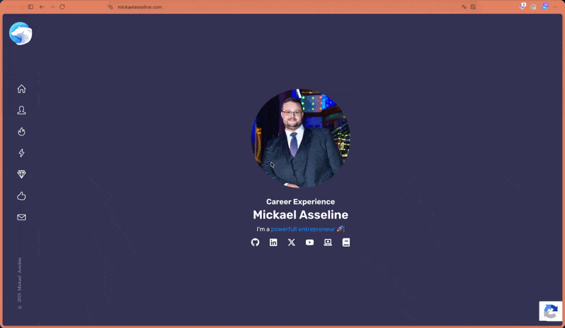

<p align="center">
  <a href="https://papamica.com">
    
  </a>
</p>

<p align="center">
  <a href="#"></a>
</p>
<p align="center">
    Firefox extension for everyday web investigation and development. </br>
Technologies, IP / ASN, WHOIS / RDAP, DNS, TLS certificate and HTTP headers — all in one popup.
</p>



## Features

| Tab | What you get |
| --- | --- |
| **Overview** | Hosting, technologies, certificate, domain and security headers at a glance |
| **Tech** | 500+ technology signatures with versions when available |
| **IP / ASN** | Contacted IP, geolocation, ASN / ISP, reverse DNS, IP RDAP |
| **Domain** | Registrar, dates, DNSSEC, nameservers + A / AAAA / NS / MX / SPF / DMARC / CAA / SOA |
| **Certificate** | TLS version, cipher, SAN, key, fingerprints, chain, PEM export |
| **Headers** | Redirect chain, security header checklist, info-leak headers, raw response |

Also includes quick links to OSINT tools (Shodan, Censys, VirusTotal, crt.sh, SSL Labs, and more), prefilled with the current host / IP / ASN.

## Install (temporary — development)

1. Open `about:debugging#/runtime/this-firefox` in Firefox
2. Click **Load Temporary Add-on…**
3. Select `manifest.json` from this folder
4. Reload open tabs — certificate and headers are captured during page load

Temporary add-ons are removed when Firefox restarts.

## Publish on Firefox Add-ons (AMO)

Everything needed for submission is documented in [`AMO.md`](AMO.md) (listing copy, reviewer notes, checklist).

```bash
./scripts/package.sh
# → web-ext-artifacts/webtool_inspector-1.1.2.zip
```

Then upload that ZIP at [addons.mozilla.org/developers](https://addons.mozilla.org/developers/addon/submit/).  
Privacy policy: [`PRIVACY.md`](PRIVACY.md).

## Privacy note

Lookups for IP geolocation / ASN, DNS-over-HTTPS and RDAP contact third-party services (Cloudflare DoH, ipwho.is, ipinfo.io, rdap.org). Technology logos load from Simple Icons / favicon CDN. No API keys are required. See [PRIVACY.md](PRIVACY.md).

## Stack

- Manifest V2 (required for Firefox `webRequest.getSecurityInfo`)
- Custom technology detector (headers, cookies, meta, JS globals, DOM, scripts, CDN URLs, WordPress assets)
- Built-in X.509 DER parser for certificate details beyond the Firefox security API

## License

MIT
